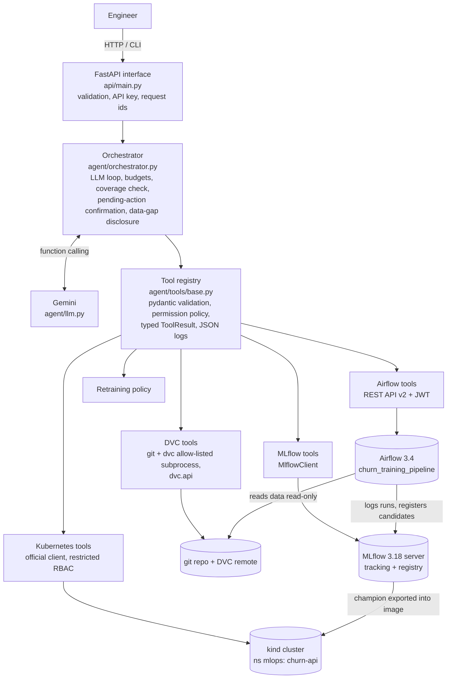

# Architecture

## 1. Overview

The MLOps agent answers natural-language operational questions about a customer-churn ML system.
It gets every operational fact from a tool call against the real system, never from model memory.



| Layer | Technology | Where |
|---|---|---|
| Interface | FastAPI (`/agent/query`, `/agent/confirm`, `/agent/pending`, `/tools`), interactive CLI | `api/main.py`, `agent/main.py` |
| Agent | Gemini (`gemini-flash-lite-latest`) with manual function calling | `agent/orchestrator.py`, `agent/llm.py` |
| Tools | 36 tools in 5 modules | `agent/tools/*.py` |
| Data versioning | DVC 3 + git tags `data-v1.0/v1.1/v2.0`, local remote | `dvc.yaml`, `data/raw/churn.csv.dvc` |
| Experiments | MLflow 3.18 (Docker), experiments `churn-baseline`, `churn-training-pipeline`, registry `churn-classifier` | `docker-compose.yml`, `scripts/seed_experiments.py` |
| Orchestration | Airflow 3.4 standalone (Docker), DAG `churn_training_pipeline` | `dags/training_pipeline.py` |
| Serving | FastAPI inference service on Kubernetes (kind), 2 replicas | `serving/`, `kubernetes/` |

## 2. Request flow (mandatory integration scenario)

*"Find the best recent model, identify the dataset version used to train it, check the deployment
status, and explain whether retraining is necessary."*

1. The API validates the request and passes it to `MLOpsAgent.run` under a new request id.
2. Gemini receives the system prompt and 36 function declarations, generated from each tool's
   pydantic input schema. It plans and issues parallel calls: `find_best_model`,
   `get_model_versions`, `get_deployed_version`, `diagnose_service`, `get_dag_runs`, `get_retraining_policy`.
3. Each call goes through `ToolRegistry.execute`, which validates arguments, enforces the
   confirmation policy, runs the tool, maps every failure to a typed status, and logs one JSON line.
4. Results go back to the model as structured `{status, data, error, evidence_source}` objects. MLflow's
   free-text dataset tag is labelled `dataset_version_tag_unverified`, so the model resolves
   provenance through DVC: `get_dataset_version(git_commit, expected_md5)` and `get_dataset_history`.
5. **Coverage check:** if the model tries to answer before querying every system the question
   involves (keyword → module map), the orchestrator sends it back once to finish.
6. The model evaluates each policy rule as triggered / not triggered / unknown, and answers with
   **Known facts / Uncertainties / Recommended actions**.
7. The orchestrator appends a deterministic **Data gaps** section for any tool that didn't return
   evidence, plus any **pending actions**.

Actual outcome (see `docs/conversations/05_multi_tool_reasoning.md`): the champion (v1) was
trained on dataset **v1.1**, while **v2.0** is the latest version, so `DATA_FRESHNESS` is triggered.
Gate-passing candidates trained on v2.0 already exist, so the agent recommends reviewing and promoting
a candidate instead of retraining. It doesn't trigger anything.

## 3. Structured tool contract

```python
class ToolResult(BaseModel):
    tool: str
    status: ok | error | unavailable | timeout | invalid_request | confirmation_required | forbidden
    request_id: str
    duration_ms: float
    data: dict | None  # always None unless status == ok
    error: str | None  # redacted
    evidence_source: list[str]  # e.g. "GET /api/v2/dags/x/dagRuns", "MlflowClient.search_runs"
```

Tools never raise into the agent loop. A failure is data with `data: null`, so evidence and
absence of evidence can't be confused.

## 4. Tools and permissions

| Module | Read-only tools | State-changing tools (confirmation required) | Interface |
|---|---|---|---|
| DVC (8) | list_datasets, get_dataset_version, get_dataset_history, compare_dataset_versions, check_dataset_changes, explain_dataset_reproduction, reproduce_dataset (sandbox dir only) | restore_dataset_workspace | allow-listed `git`/`dvc` subprocess (`shell=False`), `dvc.api`, DVC config API |
| MLflow (7) | list_experiments, list_training_runs, get_run_details, find_best_model, compare_model_runs, compare_experiments, get_model_versions | none (promotion is a human decision) | `MlflowClient` |
| Airflow (7) | list_dags, get_dag_runs, get_dag_run_status, get_failed_tasks, get_task_logs, diagnose_dag_run | trigger_training_pipeline | REST API v2, JWT from `/auth/token` |
| Kubernetes (13) | list_pods, list_deployments, get_pod_status, get_pod_logs, list_services, inspect_service, find_unhealthy_pods, get_events, get_deployed_version, diagnose_service | restart_deployment, scale_deployment, rollback_deployment | official Python client |
| Policy (1) | get_retraining_policy | none | config |

### Safety layers for state-changing operations

1. **LLM cannot self-approve.** A call to a confirmation-required tool returns
   `confirmation_required` and is parked as a `PendingAction` (id, tool, exact arguments, 15-minute TTL).
   Only `POST /agent/confirm {action_id}` runs it: once, with exactly those arguments.
2. **Allow-lists.** Airflow: only DAGs in `AIRFLOW_APPROVED_DAGS`, only known `config` keys.
   Kubernetes: only namespaces in `K8S_APPROVED_NAMESPACES`, only Deployments labelled
   `app.kubernetes.io/part-of=mlops-agent`, at most `K8S_MAX_REPLICAS` replicas.
   DVC: only allow-listed sub-commands; revisions and paths regex-validated (no option injection, no `..`).
3. **Least-privilege credentials.** The agent's Kubernetes ServiceAccount (`kubernetes/agent-rbac.yaml`)
   can read the app's resources and patch Deployments **in `mlops` only**. It can't delete, read
   secrets, or see other namespaces (verified with `kubectl auth can-i`). The Airflow project mount is read-only.
4. **Secrets** live only in the git-ignored `.env` / `.secrets/`. Logs and tool outputs pass through
   `redact()`, which masks bearer tokens, JWTs, API keys, URL credentials and `password=` patterns.

## 5. Training pipeline (Airflow)

```
validate_dataset → preprocess_data → train_model → evaluate_and_log (MLflow) → quality_gate → register_candidate
```

- **Retries:** 2 retries with a 10 s delay. Deterministic failures (`DATA_VALIDATION_FAILED`,
  `QUALITY_GATE_FAILED`) raise `AirflowFailException`, which skips retries.
- **Promotion safety:** `register_candidate` runs only if every upstream task succeeded, and only
  sets the `candidate` alias; `champion` is changed by a human.
- **Gate:** F1 ≥ 0.48, ROC-AUC ≥ 0.70, and no more than 0.02 F1 regression vs. the champion.
- **Provenance:** every run is tagged with `git_commit` + `dataset_md5`, which the DVC tools resolve to a dataset version.

## 6. Serving (Kubernetes)

`churn-api` Deployment (2 replicas, `maxUnavailable: 0`):
- **Probes:** startup, readiness (= model loaded) and liveness.
- **Resources:** requests 100m / 256Mi, limits 500m / 512Mi.
- **Security:** non-root, all capabilities dropped.
- **Configuration and lineage:** settings come from a ConfigMap; model lineage is recorded in annotations.
- **Networking:** the ClusterIP Service `churn-api:80`.

The image contains the MLflow `champion` model exported by `serving/export_model.py`, which refuses
to export if DVC can't verify the model's dataset provenance.

## 7. Observability

One JSON line per event: `tool_call` (tool, module, status, duration_ms, request_id, error),
`llm_call` (model, duration, function_calls, token counts), `agent_request` / `agent_response`
(steps, tool_calls, pending, data_gaps), `agent_coverage_nudge`, `action_confirmed`,
`http_request`. No prompts, tool payloads or secrets are logged.

## 8. Design decisions

| Decision | Reason |
|---|---|
| Direct Gemini function calling, no LangGraph/LangChain | The assignment allows direct tool calling; the registry already provides typed tools, permissions and tracing. Fewer dependencies, and every control is explicit and testable. |
| No LangSmith | Tracing is covered by structured logs; avoids sending prompts and tool outputs to a third party. |
| Provider-neutral message format + `LLMClient` protocol | Orchestrator tests use a scripted LLM and are deterministic; the provider can be swapped. |
| Coverage check in code | A lightweight model sometimes answered after one round of calls; a deterministic check makes multi-system questions reliable without a heavier model. |
| Parked actions instead of a `confirmed` flag from the LLM | The model can't confirm its own action; confirmation binds to the exact arguments shown to the user. |
| Version = md5 match against tagged versions | A commit after `data-v2.0` that only changed code is still correctly reported as `v2.0`; labels can't drift from content. |
| Model built into the image | Reproducible, offline-capable pods; `/version` and annotations record exactly what is served. |
| kind instead of a cloud cluster | Real Kubernetes API, probes, RBAC and rollouts on a laptop; the manifests are cluster-agnostic. |

## 9. Known limitations and improvements

- **Single-process state.** Sessions and pending actions are in-memory and lost on restart.
  Production should store them in Redis or a database with user identity on confirmations.
- **No production feedback loop.** `PRODUCTION_DEGRADATION` can only be evaluated from metrics
  the user supplies. A monitoring job (e.g. Evidently/Prometheus) should log live performance to
  MLflow so the rule can be evaluated automatically.
- **Local, single-node infrastructure.** The local DVC remote, SQLite-backed MLflow and Airflow
  standalone are demo-grade. Production would use object storage, Postgres, and the CeleryExecutor
  or KubernetesExecutor.
- **Model promotion is manual.** A promotion tool with confirmation plus an automated rollout of
  the new image (GitOps) would close the loop.
- **Short-lived agent token.** The Kubernetes token expires after 24 hours and has to be renewed with
  `scripts/k8s_agent_kubeconfig.sh`; production would use workload identity.
- **LLM variability.** A lightweight model can mis-state secondary details (e.g. which registry
  versions currently hold an alias). The answer format requires a source tool for each fact, and the
  raw evidence is available with `include_evidence=true` for auditing.
